# Kivo — Semana 7 (PFY2201) · React + Vite

Tienda de videojuegos **Kivo** reconstruida como aplicación **React** creada con **Vite** y **npm**.
Continúa el eCommerce de las semanas anteriores, ahora con **componentes funcionales**, **props**, el hook **`useState`** y **renderizado condicional**.

**Actividad formativa 7:** Construyendo componentes funcionales en React para un eCommerce interactivo.
**Alumna:** Lisbeth Bilbao · Desarrollo Frontend I (PFY2201) · Duoc UC

## Enlaces

- **Repositorio:** https://github.com/L1sbethBilbao/bi8_Exp3_S7_lisbeth_bilbao
- **Sitio publicado (GitHub Pages, rama `gh-pages`):** https://l1sbethbilbao.github.io/bi8_Exp3_S7_lisbeth_bilbao/

## Funcionalidades

- **Listado de productos:** cada juego muestra imagen, nombre, categoría, descripción corta, **precio normal** (tachado), **precio oferta** e insignia con el % de descuento.
- **Carrito de compras:**
  - Agregar juegos desde cada tarjeta. Si el juego ya está, suma una unidad.
  - Botones **+** y **−** para cambiar la cantidad. Con 1 unidad, **−** lo saca del carrito.
  - Botón **Quitar** para eliminar un juego completo y **Vaciar carrito** para dejarlo en cero.
  - **Contador** del total de productos en el navbar y en el carrito.
  - **Total** a pagar con los precios de oferta y el **ahorro** obtenido.
  - El carrito se guarda en `localStorage` con `useEffect`, así no se pierde al recargar.
- **Buscador y filtro por categoría:** filtran el catálogo mientras se escribe (`onChange`), también desde el menú **Categorías** del navbar.
- **Formulario de contacto:** campos controlados, validación y envío simulado con una promesa (estados enviando, éxito y error).
- **Diseño responsivo** con Bootstrap 5 instalado por npm y los estilos propios de Kivo.

## Tecnologías

| Herramienta | Uso |
|---|---|
| React 19 | Librería para construir la interfaz con componentes |
| Vite 8 | Servidor de desarrollo (`npm run dev`) y bundler (`npm run build`) |
| npm | Gestor de paquetes (`package.json` y `package-lock.json`) |
| Bootstrap 5 | Grilla, navbar, carrusel y formularios (instalado con npm, no por CDN) |
| ESLint | Revisa buenas prácticas del código (`npm run lint`) |
| gh-pages | Publica la carpeta `dist/` en la rama `gh-pages` (`npm run deploy`) |

## Cómo ejecutar el proyecto

Requisito: [Node.js](https://nodejs.org/) LTS instalado.

```bash
git clone https://github.com/L1sbethBilbao/bi8_Exp3_S7_lisbeth_bilbao.git
cd bi8_Exp3_S7_lisbeth_bilbao
npm install
npm run dev
```

Abrir http://localhost:5173/bi8_Exp3_S7_lisbeth_bilbao/

| Comando | Qué hace |
|---|---|
| `npm install` | Descarga las dependencias en `node_modules/` (esa carpeta no se sube al repositorio) |
| `npm run dev` | Levanta el servidor de desarrollo con recarga automática (HMR) |
| `npm run lint` | Revisa el código con ESLint |
| `npm run build` | Genera la versión de producción en `dist/` (transpila, empaqueta y minifica) |
| `npm run preview` | Muestra el sitio tal como quedará en producción, desde `dist/` |
| `npm run deploy` | Ejecuta `build` y publica `dist/` en la rama `gh-pages` |

## Estructura del proyecto

```
bi8_Exp3_S7_lisbeth_bilbao/
├── index.html              # HTML base con <div id="root">
├── package.json            # Dependencias y scripts
├── package-lock.json       # Versiones exactas de las librerías
├── vite.config.js          # base: '/bi8_Exp3_S7_lisbeth_bilbao/' para GitHub Pages
├── eslint.config.js        # Reglas de ESLint
├── public/img/             # Imágenes de los juegos, logo, banner y favicon
├── docs/capturas/          # Capturas de este README
└── src/
    ├── main.jsx            # Punto de entrada: Bootstrap + estilos + <App />
    ├── App.jsx             # Estado (useState) y funciones del carrito y filtros
    ├── components/
    │   ├── Navbar.jsx      # Menú, categorías y contador del carrito
    │   ├── Hero.jsx        # Portada con carrusel (useEffect + useRef)
    │   ├── SearchBar.jsx   # Buscador y selector de categoría (onChange)
    │   ├── ProductList.jsx # Grilla que recorre los juegos con .map()
    │   ├── ProductCard.jsx # Tarjeta reutilizable de un juego
    │   ├── Cart.jsx        # Carrito: vacío o con juegos
    │   ├── CartItem.jsx    # Línea del carrito con + / − / Quitar
    │   ├── CartTotal.jsx   # Total a pagar
    │   ├── ContactForm.jsx # Formulario controlado con envío simulado
    │   └── Footer.jsx      # Pie de página
    ├── data/productos.js   # Catálogo: nombre, precio, precio oferta, descripción, imagen
    ├── utils/
    │   ├── formato.js      # formatearPrecio y calcularDescuento
    │   └── carrito.js      # contarProductos, calcularTotal y calcularAhorro
    └── styles/estilos.css  # Estilos propios de Kivo
```

### Cómo se conectan los componentes

`App` guarda el estado y lo reparte por **props**. Los hijos no modifican el estado directamente: llaman a las funciones que reciben (`onAgregar`, `onQuitar`, etc.).

```
App (useState: carrito, busqueda, categoria)
├── Navbar       ← cantidad, categorias, onElegirCategoria
├── Hero         ← destacados
├── SearchBar    ← busqueda, categoria, onCambiarBusqueda, onCambiarCategoria, onLimpiar
├── ProductList  ← juegos filtrados, carrito, onAgregar
│   └── ProductCard (una por juego) ← juego, cantidadEnCarrito, onAgregar
├── Cart         ← items, onAumentar, onDisminuir, onQuitar, onVaciar
│   ├── CartItem (uno por juego) ← item, onAumentar, onDisminuir, onQuitar
│   └── CartTotal ← items
├── ContactForm  (estado propio: datos, estado, mensaje)
└── Footer
```

## Cumplimiento de la pauta de evaluación

| Criterio | Dónde se cumple |
|---|---|
| 1. Listado con nombre, precio, oferta, descripción e imagen | `ProductCard.jsx` + `data/productos.js` |
| 2. Carrito: agregar, eliminar, total de productos y precio | `App.jsx` (`agregarAlCarrito`, `disminuirCantidad`, `quitarDelCarrito`, `vaciarCarrito`), `Cart.jsx`, `CartItem.jsx`, `CartTotal.jsx`, contador en `Navbar.jsx` |
| 3. Componentes funcionales modulares y reutilizables | 10 componentes en `src/components`, comunicados por props; `ProductCard` y `CartItem` se reutilizan por cada juego |
| 4. Eventos (`onClick`, `onChange`, etc.) | `onClick` en agregar, +, −, quitar, vaciar y categorías; `onChange` en buscador, selector y formulario; `onSubmit` en el formulario |
| 5. Renderizado condicional | Carrito vacío o con juegos; "producto" o "productos"; aviso "No hay juegos para esa búsqueda"; botón "Limpiar filtros" solo con filtros activos; insignia de descuento; aviso "Tienes N unidades en tu carrito"; ahorro; mensajes de carga, éxito y error en contacto |
| 6. Funciones reutilizables, convenciones claras y comentarios | Utilidades en `src/utils`, nombres descriptivos en español y comentarios al inicio de cada archivo y función; código revisado con ESLint |
| 7. GitHub con archivos organizados, documentación, enlaces y capturas | Este README, rama `main` con el código fuente y rama `gh-pages` con el sitio publicado |

## Capturas de pantalla

### Portada y catálogo
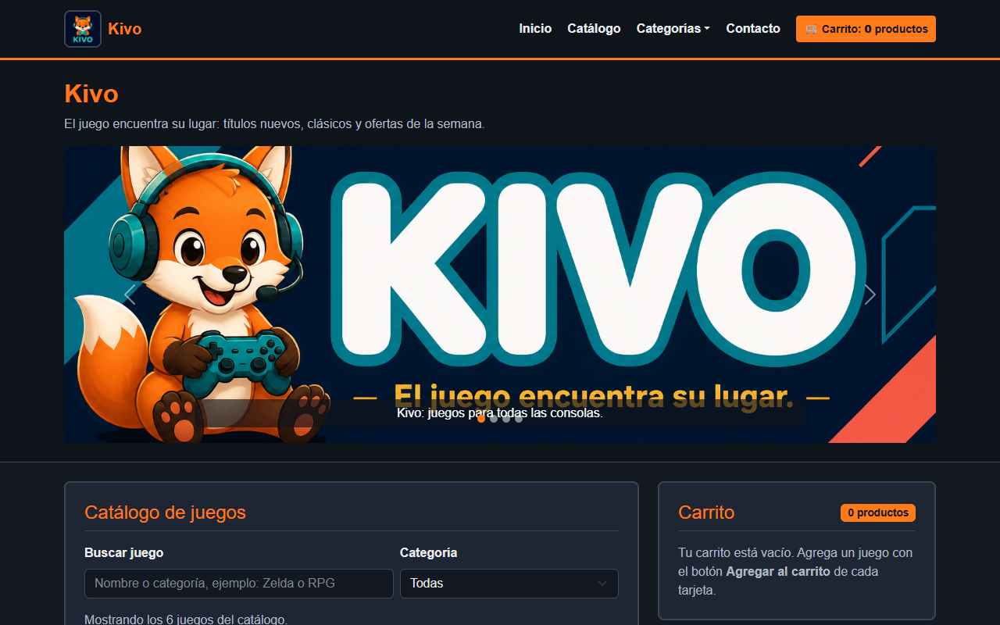

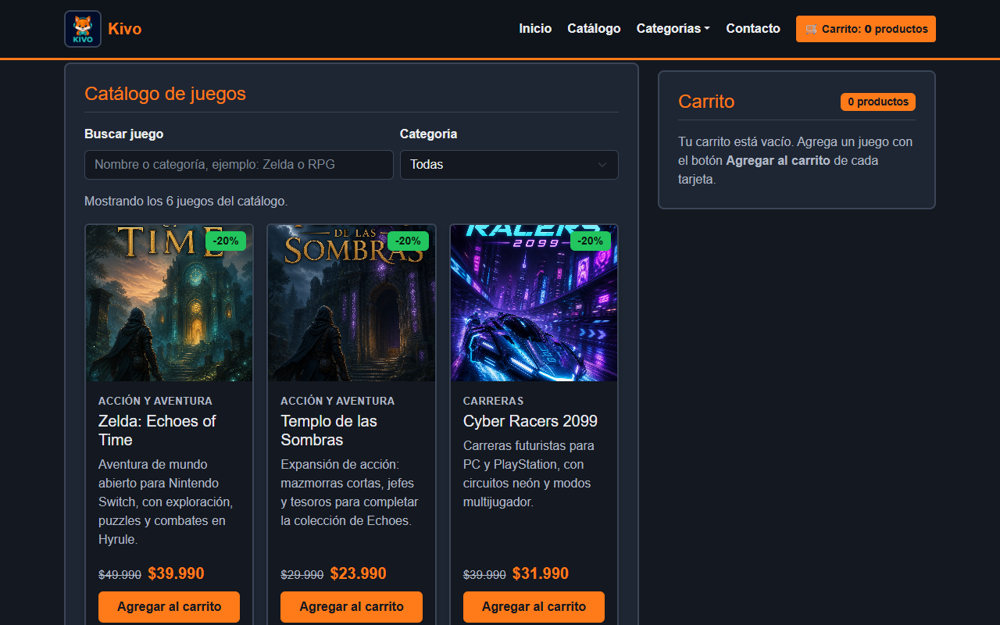

### Carrito
Agregar productos: contador en el navbar, cantidades, subtotales, ahorro y total.
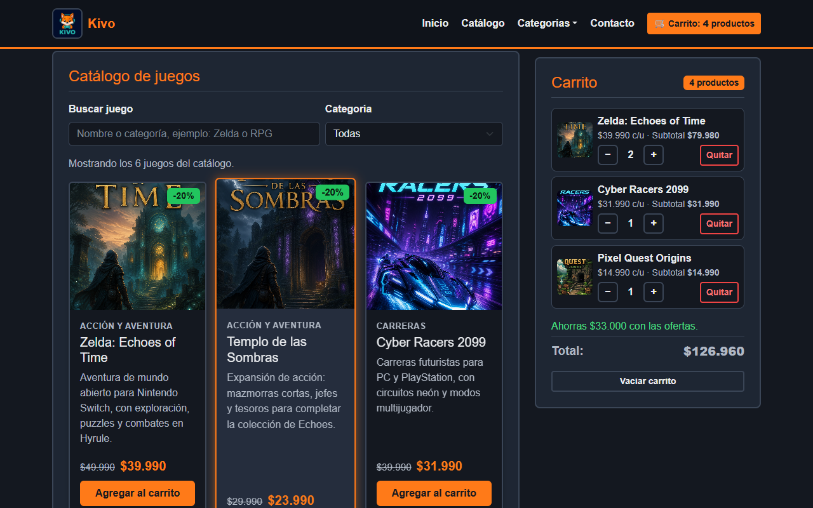

Restar una unidad (Zelda pasa de 2 a 1) y quitar un juego (Pixel Quest Origins): el contador y el total se actualizan.
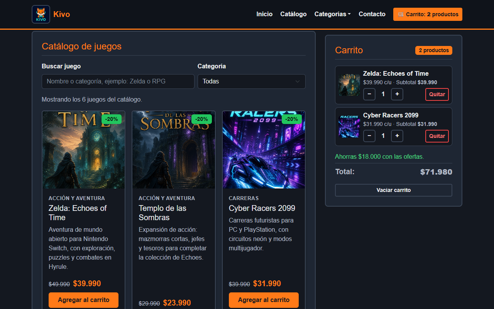

### Buscador y filtros
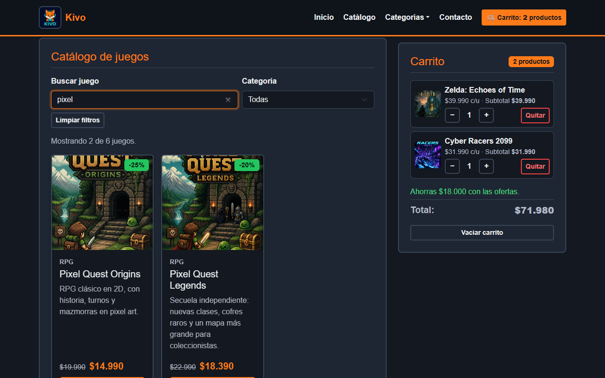

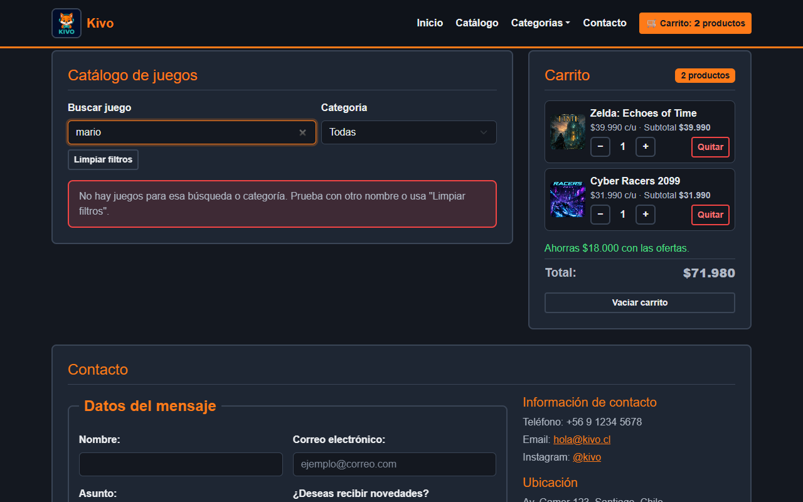

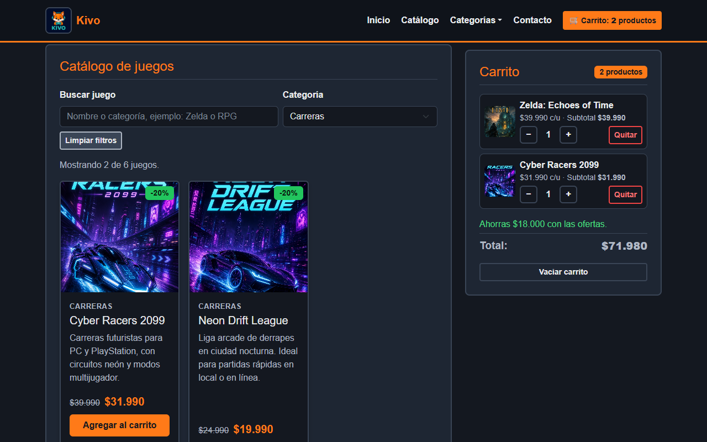

### Formulario de contacto
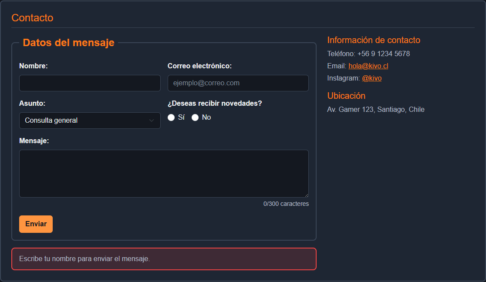

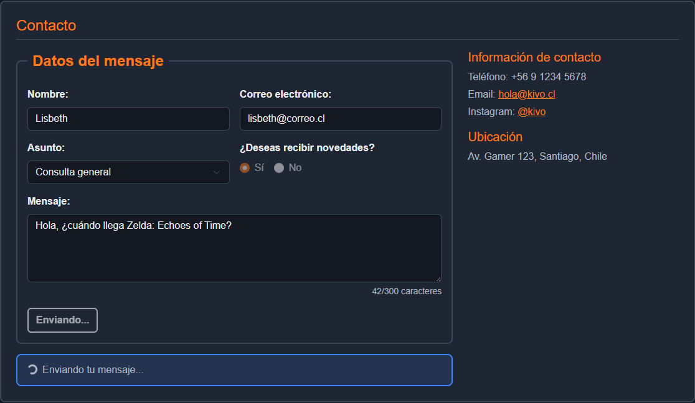

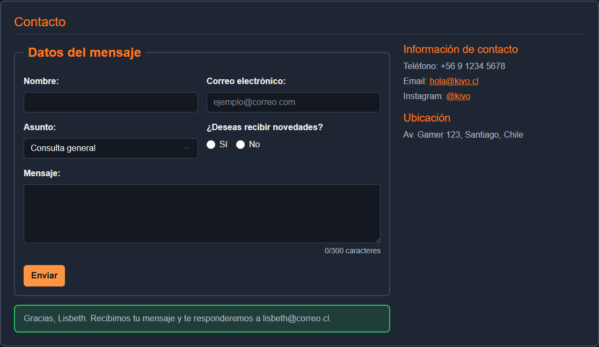

Para probar el error del envío simulado, usa el correo `falla@kivo.cl`.

### Vista en celular
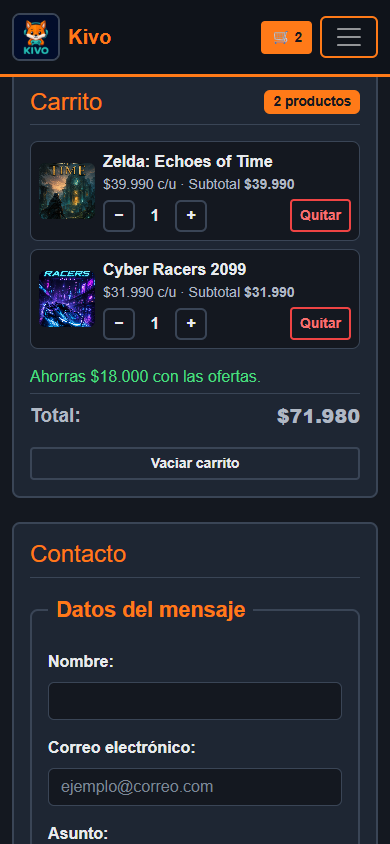

## Contenidos de la semana 7 aplicados

- Proyecto creado con `npm create vite@latest` (React + JavaScript), sin React "hecho a mano".
- `package.json` con `dependencies` (react, react-dom, bootstrap) y `devDependencies` (vite, eslint, gh-pages).
- Componentes funcionales en archivos `.jsx` (JSX).
- `useState` para el carrito, los filtros y el formulario, actualizando con el estado anterior (`prev`).
- Props para pasar datos y funciones entre componentes.
- Renderizado condicional con operador ternario `? :` y `&&`.
- `useEffect` para guardar el carrito y para iniciar el carrusel.
- Build de producción en `dist/` y despliegue en GitHub Pages con `gh-pages`.
